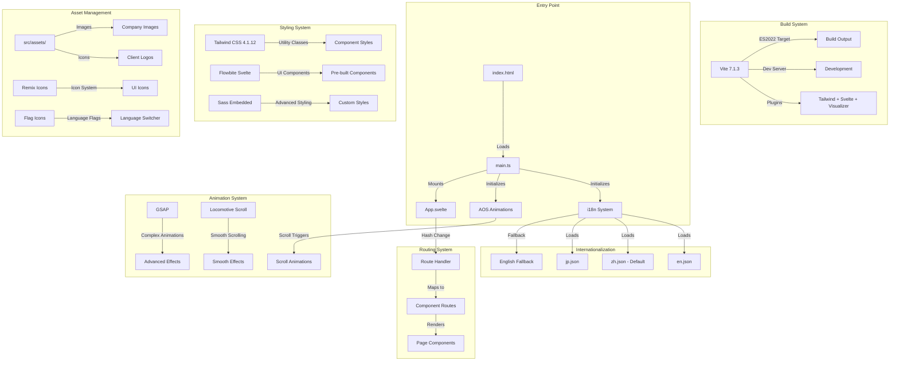
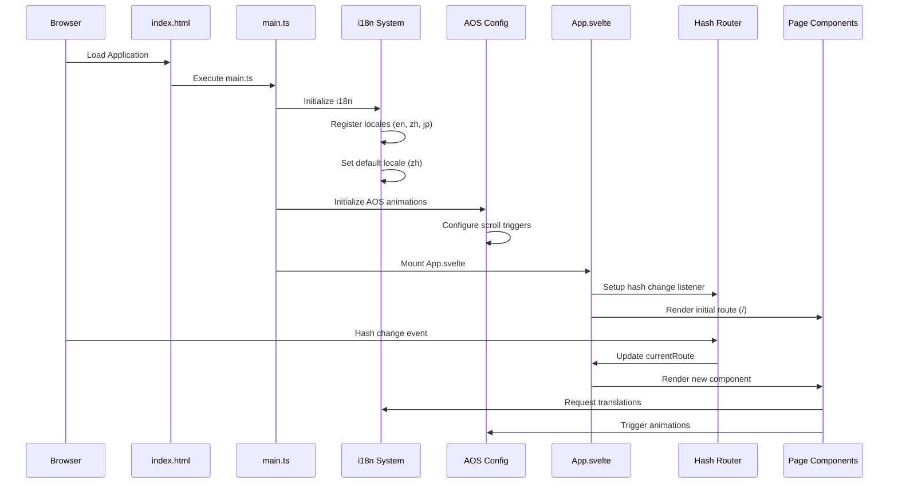
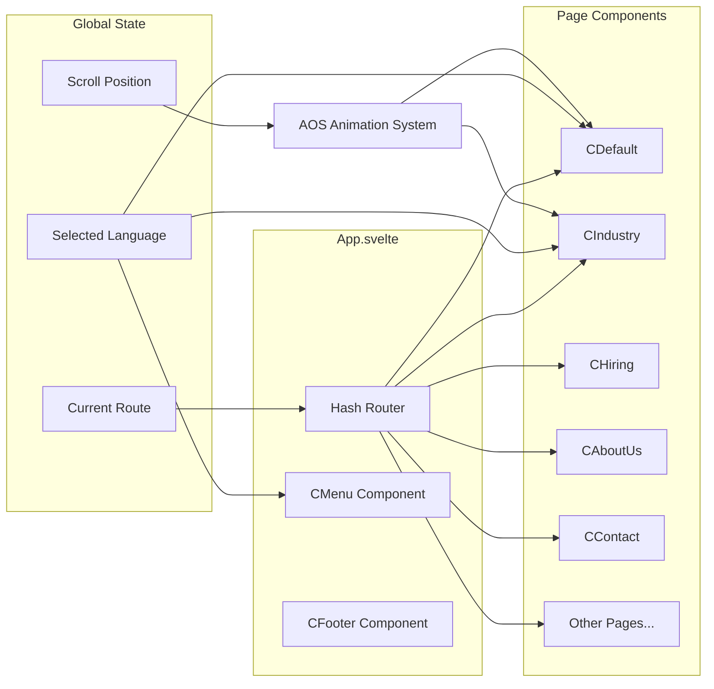
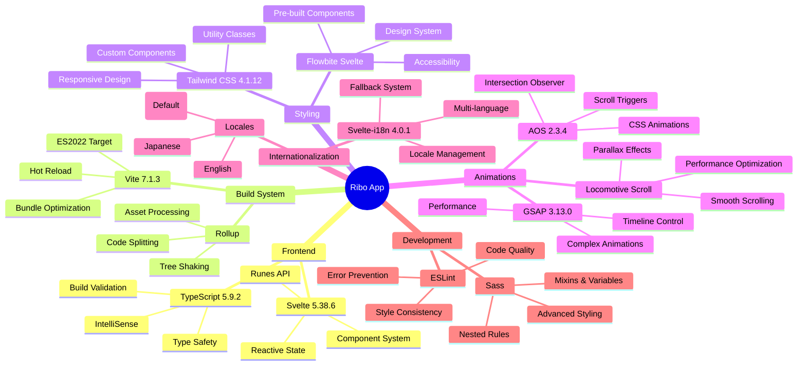

# Ribo Application Architecture Diagram

## Complete Technology Stack & Architecture

### Core Technologies
- **Frontend Framework**: Svelte 5.38.6 (Latest with runes)
- **Build Tool**: Vite 7.1.3 with ES2022 target
- **Language**: TypeScript 5.9.2
- **Styling**: Tailwind CSS 4.1.12 with @tailwindcss/vite plugin
- **UI Framework**: Flowbite Svelte 1.13.1
- **Animations**: 
  - GSAP 3.13.0 (Advanced animations)
  - AOS 2.3.4 (Animate On Scroll)
  - Locomotive Scroll 4.1.4 (Smooth scrolling)
- **Internationalization**: Svelte-i18n 4.0.1
- **Icons**: Remix Icons 4.6.0, Flag Icons 7.5.0
- **Routing**: Hash-based custom routing (not svelte-routing)
- **Development**: Sass-embedded 1.91.0, Rollup Visualizer 6.0.1

## Overview
```
┌─────────────────────────────────────────────────────────────────────────────┐
│                                MAIN APP                                     │
│  ┌───────────────────────────────────────────────────────────────────────┐  │
│  │                           APP.SVELTE                                  │  │
│  │  ┌─────────────┐  ┌─────────────────────────────────────────────────┐  │  │
│  │  │   CMenu     │  │              ROUTER/COMPONENTS                  │  │  │
│  │  │ (Navigation │  │  ┌─────────────────────────────────────────────┐  │  │  │
│  │  │  & Language)│  │  │           CDefault (Home Page)              │  │  │  │
│  │  └─────────────┘  │  │  ┌─────────────────────────────────────────┐  │  │  │  │
│  │                   │  │  │              Sections                   │  │  │  │  │
│  │                   │  │  │  ┌───────────────────────────────────┐  │  │  │  │  │
│  │                   │  │  │  │  CText (Hero Text Animation)      │  │  │  │  │  │
│  │                   │  │  │  └───────────────────────────────────┘  │  │  │  │  │
│  │                   │  │  │  ┌───────────────────────────────────┐  │  │  │  │  │
│  │                   │  │  │  │  CScroller (Scrolling Content)    │  │  │  │  │  │
│  │                   │  │  │  └───────────────────────────────────┘  │  │  │  │  │
│  │                   │  │  │  ┌───────────────────────────────────┐  │  │  │  │  │
│  │                   │  │  │  │  CSponsor (Client Logos)          │  │  │  │  │  │
│  │                   │  │  │  └───────────────────────────────────┘  │  │  │  │  │
│  │                   │  │  │  ┌───────────────────────────────────┐  │  │  │  │  │
│  │                   │  │  │  │  CLastNews (News Carousel)        │  │  │  │  │  │
│  │                   │  │  │  └───────────────────────────────────┘  │  │  │  │  │
│  │                   │  │  └─────────────────────────────────────────┘  │  │  │  │
│  │                   │  │  ┌─────────────────────────────────────────┐  │  │  │  │
│  │                   │  │  │              Other Pages                │  │  │  │  │
│  │                   │  │  │  ┌───────────────────────────────────┐  │  │  │  │  │
│  │                   │  │  │  │  CIndustry (Industry Solutions)   │  │  │  │  │  │
│  │                   │  │  │  └───────────────────────────────────┘  │  │  │  │  │
│  │                   │  │  │  ┌───────────────────────────────────┐  │  │  │  │  │
│  │                   │  │  │  │  CHiring (Headhunting Services)   │  │  │  │  │  │
│  │                   │  │  │  └───────────────────────────────────┘  │  │  │  │  │
│  │                   │  │  │  ┌───────────────────────────────────┐  │  │  │  │  │
│  │                   │  │  │  │  CResources (Staffing Services)   │  │  │  │  │  │
│  │                   │  │  │  └───────────────────────────────────┘  │  │  │  │  │
│  │                   │  │  │  ┌───────────────────────────────────┐  │  │  │  │  │
│  │                   │  │  │  │  COutSourcing (ITO Services)      │  │  │  │  │  │
│  │                   │  │  │  └───────────────────────────────────┘  │  │  │  │  │
│  │                   │  │  │  ┌───────────────────────────────────┐  │  │  │  │  │
│  │                   │  │  │  │  CAboutUs (Company Info)          │  │  │  │  │  │
│  │                   │  │  │  └───────────────────────────────────┘  │  │  │  │  │
│  │                   │  │  │  ┌───────────────────────────────────┐  │  │  │  │  │
│  │                   │  │  │  │  CContact (Contact Form)          │  │  │  │  │  │
│  │                   │  │  │  └───────────────────────────────────┘  │  │  │  │  │
│  │                   │  │  │  ┌───────────────────────────────────┐  │  │  │  │  │
│  │                   │  │  │  │  CInnovation (Innovation Page)    │  │  │  │  │  │
│  │                   │  │  │  └───────────────────────────────────┘  │  │  │  │  │
│  │                   │  │  │  ┌───────────────────────────────────┐  │  │  │  │  │
│  │                   │  │  │  │  CIntro (Company Introduction)    │  │  │  │  │  │
│  │                   │  │  │  └───────────────────────────────────┘  │  │  │  │  │
│  │                   │  │  │  ┌───────────────────────────────────┐  │  │  │  │  │
│  │                   │  │  │  │  CCulture (Company Culture)       │  │  │  │  │  │
│  │                   │  │  │  └───────────────────────────────────┘  │  │  │  │  │
│  │                   │  │  │  ┌───────────────────────────────────┐  │  │  │  │  │
│  │                   │  │  │  │  CHonors (Awards & Recognition)   │  │  │  │  │  │
│  │                   │  │  │  └───────────────────────────────────┘  │  │  │  │  │
│  │                   │  │  │  ┌───────────────────────────────────┐  │  │  │  │  │
│  │                   │  │  │  │  CInfo (Company Details)          │  │  │  │  │  │
│  │                   │  │  │  └───────────────────────────────────┘  │  │  │  │  │
│  │                   │  │  └─────────────────────────────────────────┘  │  │  │  │
│  │                   │  │  ┌─────────────────────────────────────────┐  │  │  │  │
│  │                   │  │  │              Shared Components          │  │  │  │  │
│  │                   │  │  │  ┌───────────────────────────────────┐  │  │  │  │  │
│  │                   │  │  │  │  CFooter (Footer)                 │  │  │  │  │  │
│  │                   │  │  │  └───────────────────────────────────┘  │  │  │  │  │
│  │                   │  │  └─────────────────────────────────────────┘  │  │  │  │
│  │                   │  └───────────────────────────────────────────────┘  │  │
│  └───────────────────────────────────────────────────────────────────────┘  │
└─────────────────────────────────────────────────────────────────────────────┘

┌─────────────────────────────────────────────────────────────────────────────┐
│                             CONFIGURATION                                   │
│  ┌───────────────────────────────────────────────────────────────────────┐  │
│  │                        MAIN.TS (Entry Point)                          │  │
│  │  ┌──────────────────────────────────────────────────────────────────┐  │  │
│  │  │                   i18n Configuration                             │  │  │
│  │  │  ┌────────────────────────────────────────────────────────────┐  │  │  │
│  │  │  │  Locales (en.json, zh.json, jp.json)                       │  │  │  │
│  │  │  └────────────────────────────────────────────────────────────┘  │  │  │
│  │  │  ┌────────────────────────────────────────────────────────────┐  │  │  │
│  │  │  │  AOS Animation Configuration                               │  │  │  │
│  │  │  └────────────────────────────────────────────────────────────┘  │  │  │
│  │  │  ┌────────────────────────────────────────────────────────────┐  │  │  │
│  │  │  │  Locomotive Scroll Configuration                           │  │  │  │
│  │  │  └────────────────────────────────────────────────────────────┘  │  │  │
│  │  └──────────────────────────────────────────────────────────────────┘  │  │
│  └───────────────────────────────────────────────────────────────────────┘  │
└─────────────────────────────────────────────────────────────────────────────┘

┌─────────────────────────────────────────────────────────────────────────────┐
│                              STYLING                                        │
│  ┌───────────────────────────────────────────────────────────────────────┐  │
│  │                          APP.CSS                                      │  │
│  │  ┌──────────────────────────────────────────────────────────────────┐  │  │
│  │  │                   Tailwind CSS Configuration                    │  │  │
│  │  │  ┌────────────────────────────────────────────────────────────┐  │  │  │
│  │  │  │  Tailwind Config (tailwind.config.js)                      │  │  │  │
│  │  │  └────────────────────────────────────────────────────────────┘  │  │  │
│  │  └──────────────────────────────────────────────────────────────────┘  │  │
│  └───────────────────────────────────────────────────────────────────────┘  │
└─────────────────────────────────────────────────────────────────────────────┘

┌─────────────────────────────────────────────────────────────────────────────┐
│                              ASSETS                                         │
│  ┌───────────────────────────────────────────────────────────────────────┐  │
│  │                         IMAGES & ICONS                                │  │
│  │  ┌──────────────────────────────────────────────────────────────────┐  │  │
│  │  │  Public Assets (vite.svg, etc.)                                  │  │  │
│  │  └──────────────────────────────────────────────────────────────────┘  │  │
│  │  ┌──────────────────────────────────────────────────────────────────┐  │  │
│  │  │  Assets Folder (Company images, client logos, etc.)              │  │  │
│  │  └──────────────────────────────────────────────────────────────────┘  │  │
│  └───────────────────────────────────────────────────────────────────────┘  │
└─────────────────────────────────────────────────────────────────────────────┘
```

## Detailed Architecture Flow



## Component Architecture

## Business Domain & Features

### Company Profile
**大连睿柏咨询服务有限公司** (Dalian Ribo Consulting Services Co., Ltd.)
- Enterprise consulting and staffing services
- Global service network with multilingual support
- Focus on technology, automotive, and industrial sectors

### Core Business Features
1. **Enterprise Services Hub**
   - Comprehensive business solutions
   - Professional consulting team
   - 24/7 service availability
   - Global partner network

2. **Staffing & Recruitment**
   - Headhunting services (CHiring)
   - Human resources management (CResources)
   - Talent acquisition and placement

3. **Technology Services**
   - IT Outsourcing (COutSourcing)
   - Technology category solutions (CTechCategory)
   - Innovation consulting (CInnovation)

4. **Industry Solutions**
   - Automotive sector expertise
   - E-commerce solutions
   - New energy technologies
   - Semiconductor industry
   - Financial services

### Technical Features
1. **Multi-language Support** (English, Chinese, Japanese)
   - Dynamic language switching
   - Localized content for different markets
   - Cultural adaptation for Asian markets

2. **Responsive Design** 
   - Mobile-first approach with Tailwind CSS
   - Adaptive navigation (CMenu)
   - Cross-device compatibility

3. **Advanced Animations**
   - GSAP for complex transitions
   - AOS for scroll-triggered effects
   - Locomotive Scroll for smooth scrolling
   - Performance-optimized animations

4. **Component Architecture**
   - Modular Svelte components
   - Reusable UI patterns
   - Consistent design system
   - Maintainable codebase

5. **Content Management**
   - Client showcase with sponsor logos
   - News & updates carousel (CLastNews)
   - Awards and recognition display (CHonors)
   - Company culture presentation (CCulture)

6. **User Engagement**
   - Interactive contact forms (CContact)
   - Service inquiry system
   - Professional consultation booking
   - Multi-channel communication

## Routing Structure
- `#/` - Home Page (CDefault)
- `#/industry` - Industry Solutions (CIndustry)
- `#/hiring` - Headhunting Services (CHiring)
- `#/resources` - Staffing Services (CResources)
- `#/outsourcing` - IT Outsourcing (COutSourcing)
- `#/aboutus` - About Us (CAboutUs)
- `#/contact` - Contact Form (CContact)
- `#/innovation` - Innovation (CInnovation)
- `#/intro` - Company Introduction (CIntro)
- `#/culture` - Company Culture (CCulture)
- `#/honors` - Awards & Recognition (CHonors)
- `#/info` - Company Details (CInfo)

## Application Lifecycle & Data Flow



## State Management & Component Communication



## Data Flow Details
1. **Application Bootstrap** (main.ts):
   - Registers i18n locales asynchronously
   - Initializes AOS animation system
   - Imports Flowbite for UI components
   - Imports RemixIcon CSS for icons
   - Mounts App.svelte to DOM

2. **Routing System** (App.svelte):
   - Hash-based routing without external router
   - Route mapping to component instances
   - Dynamic background class application
   - Conditional footer rendering

3. **Component Rendering**:
   - Reactive component selection via $derived
   - Props passing for styling (bgClass, footer config)
   - Internationalization via svelte-i18n store
   - Animation triggers via AOS and GSAP

4. **Asset Loading**:
   - Static assets from src/assets/
   - Dynamic imports for locale files
   - CDN resources (RemixIcon)
   - Vite asset optimization

## Build & Development Configuration

### Vite Configuration Details
```typescript
// vite.config.ts
{
  esbuild: { target: 'es2022' },
  plugins: [
    tailwindcss(),           // Tailwind CSS integration
    svelte(),               // Svelte compilation
    visualizer({            // Bundle analysis
      open: true,
      filename: 'dist/stats.html'
    })
  ],
  build: {
    chunkSizeWarningLimit: 1000,
    cssCodeSplit: true,
    target: 'es2022'
  },
  optimizeDeps: {
    include: ['aos'],       // Pre-bundle AOS
    exclude: []
  }
}
```

### TypeScript Configuration
- **tsconfig.json**: Project references setup
- **tsconfig.app.json**: App-specific TypeScript config
- **tsconfig.node.json**: Node.js specific config

### Svelte Configuration
```javascript
// svelte.config.js
{
  preprocess: vitePreprocess(),
  onwarn: (warning, handler) => {
    // Suppress a11y-invalid-attribute warnings
    if (warning.code === 'a11y-invalid-attribute') return;
    handler(warning);
  }
}
```

## Build Process & Scripts
```bash
# Development with hot reload
npm run dev

# Production build with optimization
npm run build

# Preview production build locally  
npm run preview

# Type checking (Svelte + TypeScript)
npm run check
```

## Performance Optimizations
- **Code Splitting**: CSS and JS chunks
- **Bundle Analysis**: Rollup visualizer for size monitoring
- **Dependency Optimization**: AOS pre-bundled
- **ES2022 Target**: Modern JavaScript features
- **Chunk Size Limit**: 1000kb warning threshold

## Development Tools Integration
- **Svelte Inspector**: Component debugging
- **Bundle Visualizer**: Automatic stats generation
- **Type Safety**: Full TypeScript coverage
- **Hot Module Replacement**: Vite HMR for fast development

## Complete File Structure & Organization

```
ribo/
├── 📁 Configuration Files
│   ├── package.json              # Dependencies & scripts
│   ├── vite.config.ts            # Vite build configuration
│   ├── tsconfig.json             # TypeScript project references
│   ├── tsconfig.app.json         # App TypeScript config
│   ├── tsconfig.node.json        # Node TypeScript config
│   ├── svelte.config.js          # Svelte compiler config
│   ├── tailwind.config.js        # Tailwind CSS config
│   └── .eslintrc.js              # ESLint configuration
│
├── 📁 Public Assets
│   ├── index.html                # Main HTML template
│   └── public/
│       └── vite.svg              # Vite logo
│
├── 📁 Source Code (src/)
│   ├── main.ts                   # Application entry point
│   ├── App.svelte                # Root component & router
│   ├── app.css                   # Global styles
│   ├── routes.ts                 # Route definitions (unused)
│   │
│   ├── 📁 config/                # Configuration modules
│   │   ├── aos-config.ts         # AOS animation setup
│   │   ├── aos.d.ts              # AOS type definitions
│   │   ├── i18n.ts               # i18n configuration
│   │   ├── locomotive-scroll-manager.ts  # Scroll manager
│   │   ├── locomotive-scroll.css # Scroll styling
│   │   ├── locomotive-scroll.d.ts # Scroll type definitions
│   │   └── vite-env.d.ts         # Vite environment types
│   │
│   ├── 📁 features/              # Page & UI components
│   │   ├── 🏠 Core Pages
│   │   │   ├── CDefault.svelte   # Home page
│   │   │   ├── CMenu.svelte      # Navigation menu
│   │   │   └── CFooter.svelte    # Site footer
│   │   │
│   │   ├── 🏢 Business Pages
│   │   │   ├── CIndustry.svelte  # Industry solutions
│   │   │   ├── CHiring.svelte    # Headhunting services
│   │   │   ├── CResources.svelte # Staffing services
│   │   │   ├── COutSourcing.svelte # IT outsourcing
│   │   │   ├── CServe.svelte     # Service offerings
│   │   │   └── CTechCategory.svelte # Tech categories
│   │   │
│   │   ├── 🏛️ Company Pages
│   │   │   ├── CAboutUs.svelte   # About company
│   │   │   ├── CIntro.svelte     # Company introduction
│   │   │   ├── CCulture.svelte   # Company culture
│   │   │   ├── CHonors.svelte    # Awards & recognition
│   │   │   ├── CInfo.svelte      # Company details
│   │   │   └── CInnovation.svelte # Innovation page
│   │   │
│   │   ├── 📞 Contact & Engagement
│   │   │   ├── CContact.svelte   # Contact form
│   │   │   ├── CHiring.svelte    # Hiring services
│   │   │   └── CLastNews.svelte  # News carousel
│   │   │
│   │   ├── 🎨 UI Components
│   │   │   ├── CText.svelte      # Text animations
│   │   │   ├── CScroller.svelte  # Scrolling content
│   │   │   ├── CSponsor.svelte   # Client logos
│   │   │   ├── CHero.svelte      # Hero sections
│   │   │   ├── CDynamic.svelte   # Dynamic content
│   │   │   └── CTemplate.svelte  # Template component
│   │   │
│   │   ├── 🖼️ Industry Components
│   │   │   ├── IAboutUs.svelte   # Industry about
│   │   │   ├── ICarousel.svelte  # Industry carousel
│   │   │   ├── ICustomers.svelte # Industry customers
│   │   │   ├── IIntro.svelte     # Industry intro
│   │   │   ├── Industry.svelte   # Industry main
│   │   │   └── BIntro.svelte     # Business intro
│   │   │
│   │   ├── images.ts             # Image imports
│   │   └── TestImage.svelte      # Image testing
│   │
│   ├── 📁 locales/               # Internationalization
│   │   ├── en.json               # English translations
│   │   ├── zh.json               # Chinese translations (default)
│   │   ├── jp.json               # Japanese translations
│   │   └── index.d.ts            # Locale type definitions
│   │
│   └── 📁 assets/                # Static assets
│       ├── 🖼️ Images
│       │   ├── logo.png/jpg/svg  # Company logos
│       │   ├── aboutus*.jpg      # About us images
│       │   ├── automotive*.jpg   # Automotive sector
│       │   ├── ecommerce*.jpg    # E-commerce images
│       │   ├── tech*.jpg         # Technology images
│       │   ├── award_*.png       # Award images
│       │   └── preview-*.jpg     # Preview images
│       │
│       ├── 📁 icons/             # Client & partner logos
│       │   ├── alibaba.png       # Alibaba logo
│       │   ├── cisco.png         # Cisco logo
│       │   ├── hitachi.png       # Hitachi logo
│       │   ├── lenovo.png        # Lenovo logo
│       │   ├── nissan.png        # Nissan logo
│       │   └── [20+ more logos]  # Other client logos
│       │
│       └── 📁 icons-trans/       # Transparent versions
│           └── [transparent logos] # Transparent client logos
│
├── 📁 Build Output
│   └── dist/                     # Production build
│       └── stats.html            # Bundle analysis
│
├── 📁 Development Tools
│   ├── .crush/                   # Crush tool data
│   ├── .codebuddy/               # CodeBuddy configuration
│   ├── .vscode/                  # VS Code settings
│   ├── .github/                  # GitHub workflows
│   └── node_modules/             # Dependencies
│
└── 📁 Documentation
    ├── README.md                 # Project documentation
    ├── app-architecture-diagram.md # This file
    ├── CODEBUDDY.md             # CodeBuddy documentation
    ├── CRUSH.md                 # Crush tool documentation
    └── oh-my-push.md            # Push tool documentation
```

## Technology Integration Map



This comprehensive architecture diagram shows the complete technical stack, file organization, data flow, and business domain of the Ribo consulting services application. The app is built with modern web technologies focusing on performance, internationalization, and user experience for a professional consulting company serving global markets.